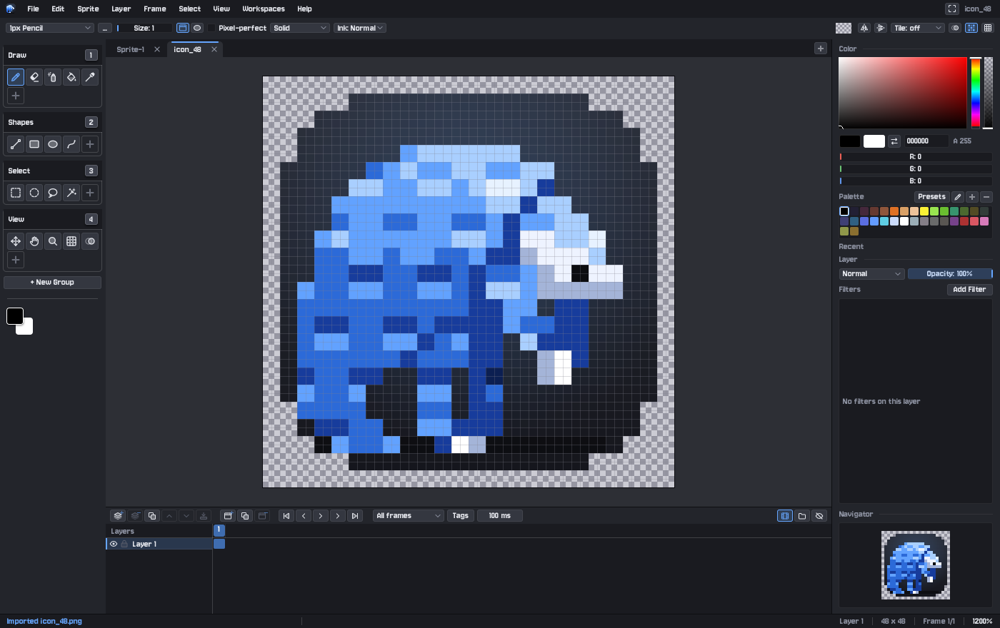
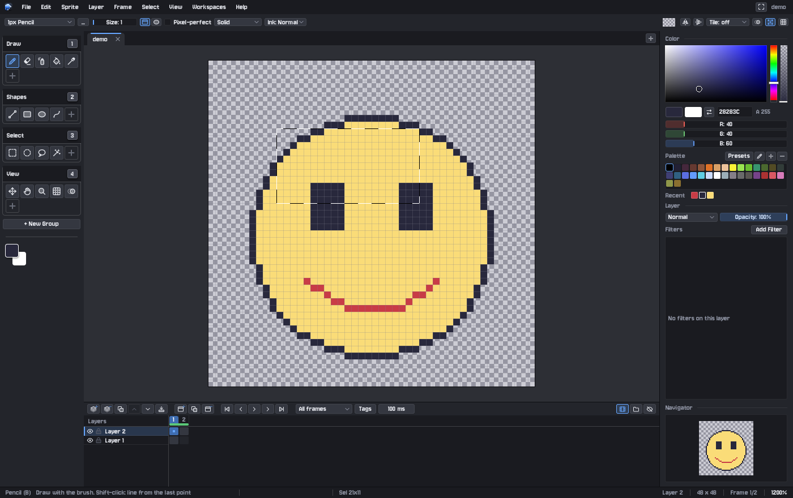

  

<h1 align="center">Pangolin Pixels</h1>

<em>Pixel art, scale by scale.</em>

  A friendly, fast pixel art editor for sprites, tiles and animation. 
  Free and open source, for Windows, macOS and Linux.

  <a href="https://github.com/BrandonHilde/PangolinPixels/releases"><strong>Download the beta</strong></a>
  ·
  <a href="GUIDE.md">Guide</a>
  ·
  <a href="DEVELOPING.md">For developers</a>

## Download

**Version 0.9.0-beta.** This is a beta: it's ready to use, and we'd love to hear what goes wrong.

| Your computer | Download |
|---|---|
| **Windows** 10 or 11 | [PangolinPixels-0.9.0-beta-windows.zip](https://github.com/BrandonHilde/PangolinPixels/releases/download/v0.9.0-beta/PangolinPixels-0.9.0-beta-windows.zip) |
| **macOS** 11 or later, Apple silicon (M1 or newer) | [PangolinPixels-0.9.0-beta-macos.zip](https://github.com/BrandonHilde/PangolinPixels/releases/download/v0.9.0-beta/PangolinPixels-0.9.0-beta-macos.zip) |
| **Linux**, 64-bit (Ubuntu 22.04, Fedora 36, Debian 12 or newer) | [PangolinPixels-0.9.0-beta-linux.tar.gz](https://github.com/BrandonHilde/PangolinPixels/releases/download/v0.9.0-beta/PangolinPixels-0.9.0-beta-linux.tar.gz) |

All versions are on the [releases page](https://github.com/BrandonHilde/PangolinPixels/releases).

### Getting started

1. **Unzip** the download anywhere you like. Nothing needs installing.
2. **Open** `PangolinPixels.exe` (Windows), `Pangolin Pixels.app` (macOS) or `PangolinPixels` (Linux).
3. **The first time only**, your computer may want to check with you, because the beta isn't signed yet:
   - **Windows:** "Windows protected your PC". Click **More info**, then **Run anyway**.
   - **macOS:** it says the app can't be opened. Go to **System Settings > Privacy & Security** and click
     **Open Anyway**. On macOS 14 or earlier, right-click the app and choose **Open**.

Each download has an `INSTALL.txt` with the details, including where your settings are kept.

## What you can do

- **Draw pixel by pixel** with a pencil (with pixel-perfect lines), eraser, lines, rectangles, ellipses, curves, a paint
  bucket, spray and dither patterns. Mirror and tiled drawing make symmetric sprites and seamless tiles easy.
- **Animate** with frames, onion skin (see the frames before and after this one), tags for each animation, and
  playback. Export animated GIFs, sprite sheets or PNG sequences.
- **Work in layers**, with opacity, blend modes and groups, plus filters you can change any time: brightness, hue,
  posterize, or mapping everything onto your palette.
- **Choose great colors** from built-in palettes such as PICO-8, DB32, Endesga 32, Sweetie 16 and Game Boy, or make your own.
- **Turn any picture into pixel art**: shrink a photo to sprite size and map it onto a palette, with optional dithering.
- **Set up your tools your way.** The toolbar is made of groups you build yourself, each on its own key: press 1 for
  drawing tools, 2 for shapes, and so on. Save whole set-ups as workspaces, such as Animation, Tiles and Shading.
- **Draw with a tablet.** Pen pressure and the eraser end work with Wacom, Huion and similar tablets.
- **Open** PNG, JPG, WebP, GIF, BMP, TGA and QOI images, and **export** PNG, animated GIF, sprite sheets and PNG
  sequences. Pixels' own project files keep every layer and frame.

Every button tells you what it does when you rest the pointer on it, and **F1** lists all the shortcuts. The
[full guide](GUIDE.md) covers everything in detail.

## The Pangolin family

Three editors with the same look and feel, so what you learn in one carries over to the others.

| | | |
|---|---|---|
|  | **[Pangolin Pixels](https://github.com/BrandonHilde/PangolinPixels)**: pixel art and sprite animation | [Download](https://github.com/BrandonHilde/PangolinPixels/releases) |
|  | **[Pangolin Paints](https://github.com/BrandonHilde/PangolinPaints)**: painting, oil paint and photo editing | [Download](https://github.com/BrandonHilde/PangolinPaints/releases) |
|  | **[Pangolin Scales](https://github.com/BrandonHilde/PangolinScales)**: vector drawings (SVG) and fonts | [Download](https://github.com/BrandonHilde/PangolinScales/releases) |

## Found a problem? Have an idea?

[Open an issue](https://github.com/BrandonHilde/PangolinPixels/issues). Please say which computer you're on and the
version from **Help > About**. A screenshot helps a lot.

## For developers

Pangolin Pixels is written in [Odin](https://odin-lang.org) with SDL3. [DEVELOPING.md](DEVELOPING.md) covers building
it, running the tests, and how the release builds are made.

## License

BSD 3-Clause. See [LICENSE](LICENSE).
